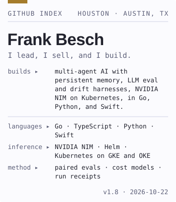
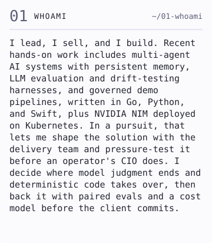
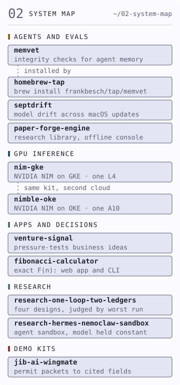
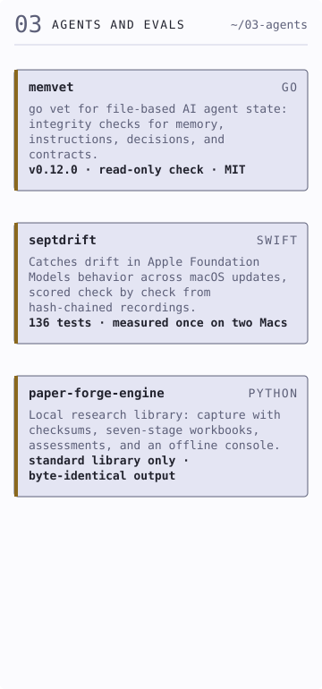
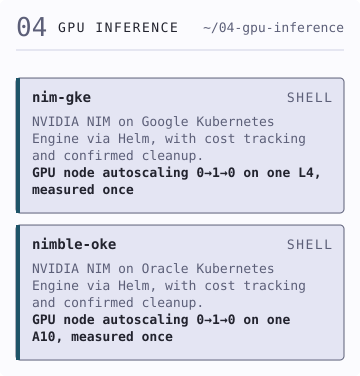
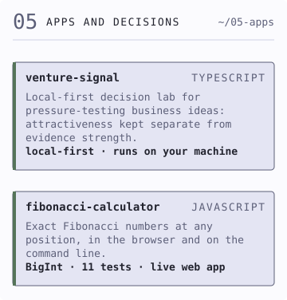
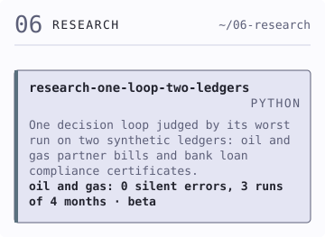
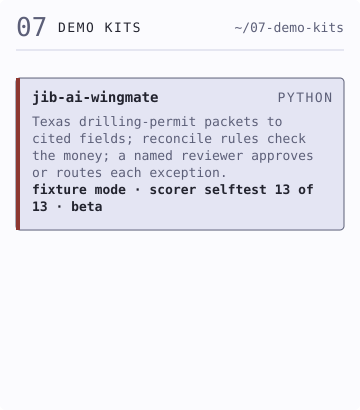

<picture><source media="(prefers-color-scheme: dark)" srcset="assets/dark/header.svg"/></picture> <picture><source media="(prefers-color-scheme: dark)" srcset="assets/dark/whoami.svg"/></picture>

[LinkedIn](https://www.linkedin.com/in/frankbesch/) · [Substack](https://frankbesch.substack.com)

Who I am, as text

Customers should see evidence before they commit. I lead teams and build the
tools that produce it.

For an oil-and-gas billing workflow, I built a document pipeline on Pulse's
parser and Claude, then tested a discriminative model on specific decisions.
In a small synthetic pilot, clearer definitions improved its results. Another
instruction fixed its target but broke answers elsewhere; only testing the
full set showed the tradeoff.

I define value with the customer first, test model judgment against known
answers, and keep deterministic checks in code. Exceptions go to a person,
with the evidence attached. The customer sees what works, what fails, and what
still needs proving.

<picture><source media="(prefers-color-scheme: dark)" srcset="assets/dark/system-map.svg"/></picture> <picture><source media="(prefers-color-scheme: dark)" srcset="assets/dark/agents.svg"/></picture>

The system map has five groups, one per project panel. Agents and evals:
[memvet](https://github.com/frankbesch/memvet), installed by
[homebrew-tap](https://github.com/frankbesch/homebrew-tap);
[septdrift](https://github.com/frankbesch/septdrift);
[paper-forge-engine](https://github.com/frankbesch/paper-forge-engine). GPU
inference: nim-gke and nimble-oke, the same NVIDIA NIM kit on two clouds.
Apps and decisions: venture-signal and fibonacci-calculator. Research:
research-one-loop-two-ledgers and research-hermes-nemoclaw-sandbox. Demo kits:
jib-ai-wingmate.

- [memvet](https://github.com/frankbesch/memvet): `go vet` for file-based AI agent state. Latest release: [v0.12.0](https://github.com/frankbesch/memvet/releases/tag/v0.12.0).
- [septdrift](https://github.com/frankbesch/septdrift): catches drift in Apple Foundation Models behavior across macOS updates. 136 tests; measured once on two Macs: [receipt](https://github.com/frankbesch/septdrift/blob/main/docs/runs/2026-09-30-m4-vs-m1.txt).
- [paper-forge-engine](https://github.com/frankbesch/paper-forge-engine): a local research library with an offline console, Python standard library only. The same inputs give byte-identical output: [golden hash](https://github.com/frankbesch/paper-forge-engine/blob/main/tests/golden/library.sha256).

<picture><source media="(prefers-color-scheme: dark)" srcset="assets/dark/gpu-inference.svg"/></picture> <picture><source media="(prefers-color-scheme: dark)" srcset="assets/dark/apps.svg"/></picture>

- [nim-gke](https://github.com/frankbesch/nim-gke): NVIDIA NIM on Google Kubernetes Engine. GPU node autoscaling 0→1→0 on one L4, measured once: [receipt](https://github.com/frankbesch/nim-gke/blob/main/docs/runs/2026-09-28-run-3-autoscale.md), [every attempt and posted cost](https://github.com/frankbesch/nim-gke/blob/main/docs/runs/README.md).
- [nimble-oke](https://github.com/frankbesch/nimble-oke): NVIDIA NIM on Oracle Kubernetes Engine. GPU node autoscaling 0→1→0 on one A10, measured once: [receipt](https://github.com/frankbesch/nimble-oke/blob/main/docs/runs/2026-10-01-run-2-autoscale.md), [every attempt and posted cost](https://github.com/frankbesch/nimble-oke/blob/main/docs/runs/README.md).
- [venture-signal](https://github.com/frankbesch/venture-signal): a local-first decision lab that keeps attractiveness separate from evidence strength.
- [fibonacci-calculator](https://github.com/frankbesch/fibonacci-calculator): exact Fibonacci numbers as BigInt, in the browser and on the command line; 11 tests. [Live app](https://frankbesch.github.io/fibonacci-calculator/), [timing receipt](https://github.com/frankbesch/fibonacci-calculator/blob/main/docs/runs/2026-10-03-methods.txt).

<picture><source media="(prefers-color-scheme: dark)" srcset="assets/dark/research.svg"/></picture> <picture><source media="(prefers-color-scheme: dark)" srcset="assets/dark/demo-kits.svg"/></picture>

- [research-one-loop-two-ledgers](https://github.com/frankbesch/research-one-loop-two-ledgers): a research study, in beta. One decision loop judged by its worst run on two synthetic ledgers, oil and gas partner bills and bank loan compliance certificates. On the oil and gas bills it let 0 silent errors through in 3 runs of 4 synthetic months: [receipt](https://github.com/frankbesch/research-one-loop-two-ledgers/blob/main/month/results/REPLICATION-RESULT-20261008.md).
- [research-hermes-nemoclaw-sandbox](https://github.com/frankbesch/research-hermes-nemoclaw-sandbox): a research study, ongoing. One agent, Hermes, run bare and inside NVIDIA NemoClaw's sandbox with the model held constant; same success on four of five tasks, one run each: [logs](https://github.com/frankbesch/research-hermes-nemoclaw-sandbox/tree/main/logs).
- [jib-ai-wingmate](https://github.com/frankbesch/jib-ai-wingmate): a demo kit, in beta. Texas drilling-permit packets to cited fields; reconcile rules check the money, and a named reviewer approves or routes each exception. Fixture mode only; scorer selftest 13 of 13 values reproduced: [receipt](https://github.com/frankbesch/jib-ai-wingmate/blob/main/demo/tests/selftest/README.md).
- Writing: 14 essays on AI, decision-making, and leadership at [Substack](https://frankbesch.substack.com). Start with [A 99% Accurate Model Can Still Be a Bad Decision](https://frankbesch.substack.com/p/accuracy-is-not-a-decision).
- Stack: Go, TypeScript, Python, Swift; NVIDIA NIM, Helm, Kubernetes on GKE and OKE; paired evals, cost models, and run receipts.

Each measured claim on this page links to its receipt. Panels v1.11 on Quoin v2.1, 2026-10-23.
